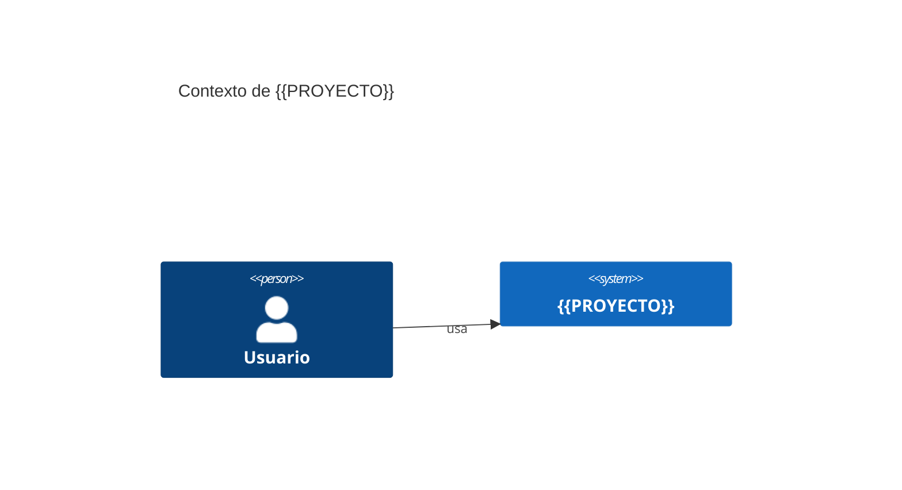
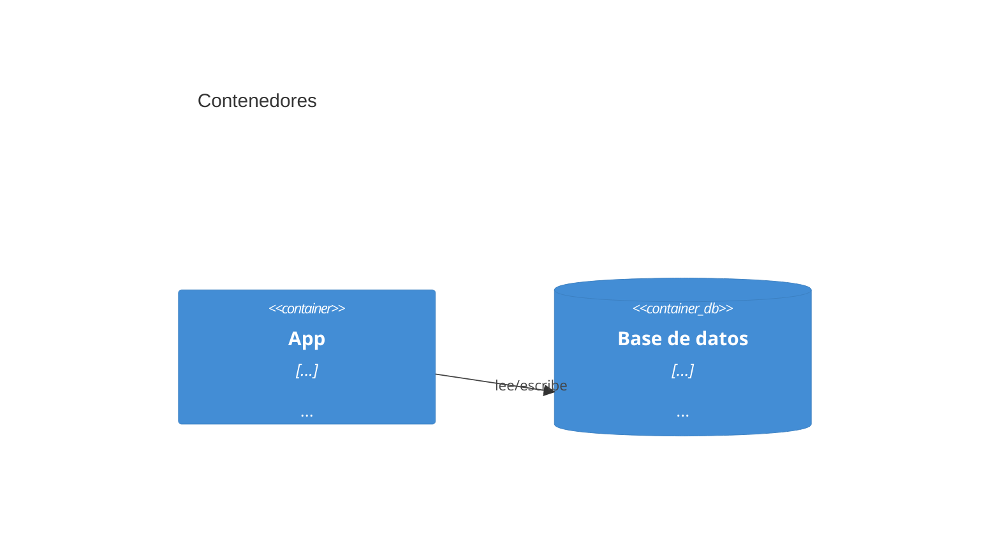

# Arquitectura de {{PROYECTO}}

## Resumen

<!-- 3 líneas: qué es, cómo está partido, qué regla de dependencia rige -->

## Contexto (C4 nivel 1)

## Contenedores (C4 nivel 2)

## Módulos y kernel

Regla: un módulo solo importa su propio código y `kernel/`. Habla con otros módulos por
`contract` o por eventos del kernel. Se vigila con: <!-- lint / grep / revisión -->

| Módulo | Expone | Consume | Eventos que emite | Apagable |
|---|---|---|---|---|
| kernel | registro, eventos, config, errores | — | — | no |

## Transversales (viven en kernel)

- Configuración
- Errores tipados
- Logging
- Auth (si aplica)

## Decisiones estructurales

Ver [adr/](adr/). Las más relevantes:

- [0001 — Adoptar el stack](adr/0001-adoptar-stack.md)
